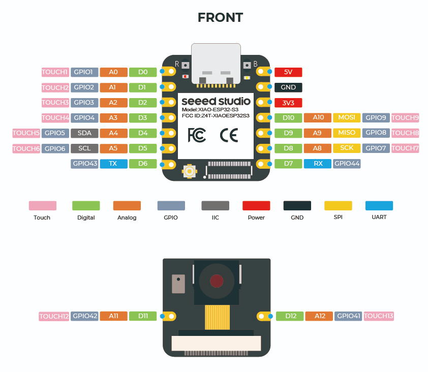

# BMP280 Temperature and Pressure Sensor

Reads temperature (°C) and pressure (hPa) every second on a XIAO ESP32S3 Sense running CircuitPython. The supplied program uses I2C address `0x77`.

## Setup

Use a USB data cable and confirm that the board appears as a `CIRCUITPY` drive. Install the computer tools if needed:

```bash
python3 -m pip install --user pyserial circup
```

On Windows, use `py` instead of `python3` throughout. If Homebrew Python reports `externally-managed-environment`, append `--break-system-packages` to the install command while keeping `--user`.

Install the sensor library once per board:

```bash
circup install adafruit_bmp280
```

The library and dependencies go into the board's `CIRCUITPY/lib/`. If detection fails, use `circup --path "PATH_TO_CIRCUITPY" install adafruit_bmp280`, replacing the placeholder with the mounted drive path.

## Wiring

Disconnect power before changing wires.

| XIAO ESP32S3 Sense | BMP280 |
| --- | --- |
| 3V3 | VIN / VCC |
| GND | GND |
| D4 / SDA / GPIO5 | SDA / SDI |
| D5 / SCL / GPIO6 | SCL / SCK |



## Run

1. Open this repository's `temperature and pressure sensor` folder.
2. Copy its `code.py` to the root of the `CIRCUITPY` drive, replacing the board's current program. Back up that program first if needed.
3. Open a terminal and run:

```bash
python3 -m serial.tools.miniterm --raw
```

Select the XIAO's USB serial port when prompted. The ESP32 runs the program; the terminal displays its readings. Do not run `code.py` with computer Python or VS Code's Python Run button.

- **Control + C**, then **Control + D**: stop and restart the board program.
- **Control + ]**: exit the serial monitor.
- After editing the repository file, copy it to the board again.

## Troubleshooting

- **No pull up found:** check power, ground, and SDA/SCL wiring.
- **Sensor not found:** check wiring and scan its I2C address; another module may use `0x76` rather than `0x77`.
- **Port busy:** close other serial monitors or the camera receiver.
- **No readings:** press Control + C, then Control + D and read any error output.

Keep `README.md`, `code.py`, and `assets/` together in this folder, and commit the image to Git so it displays for teammates.
